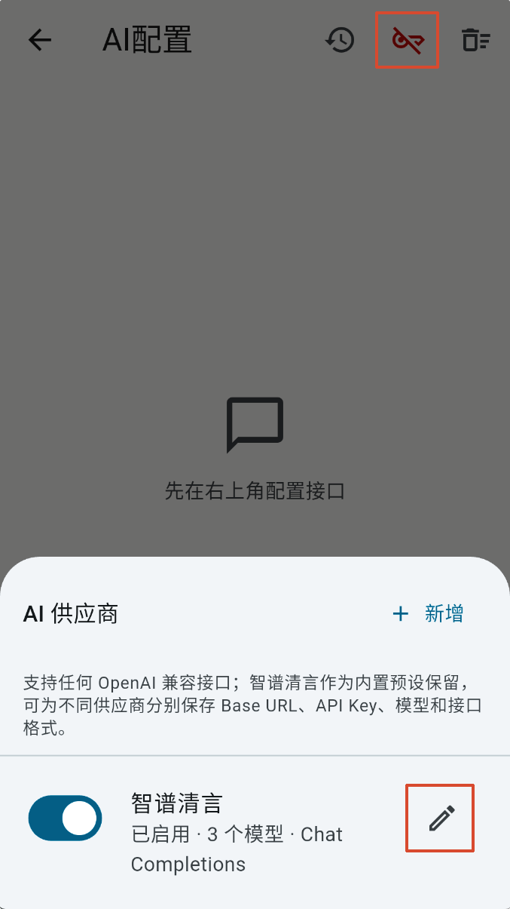
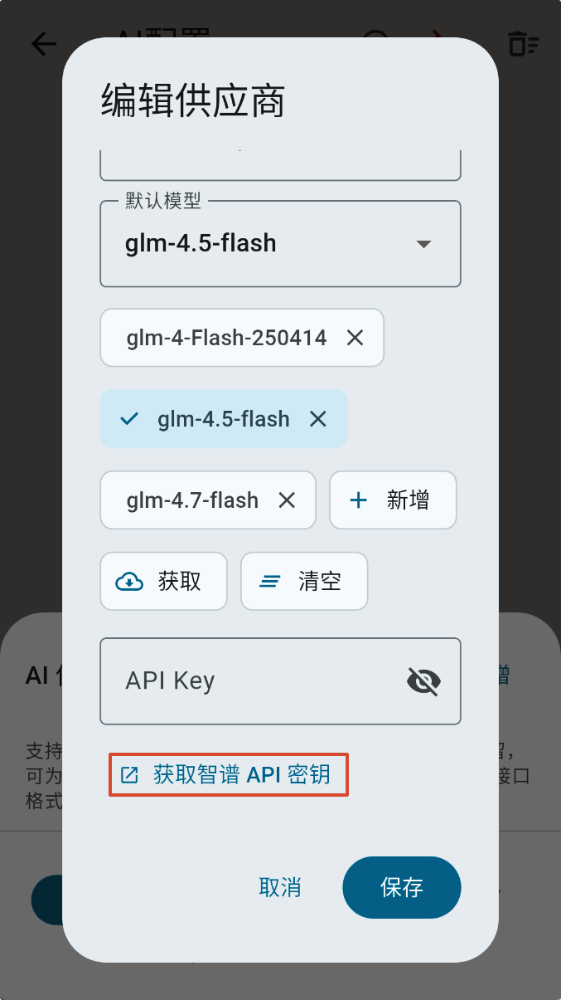
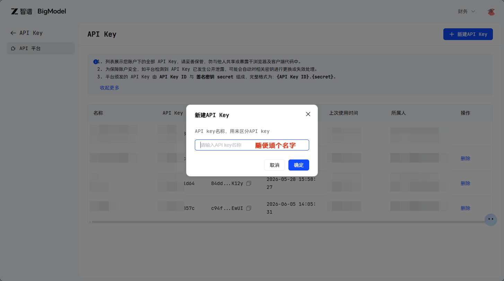
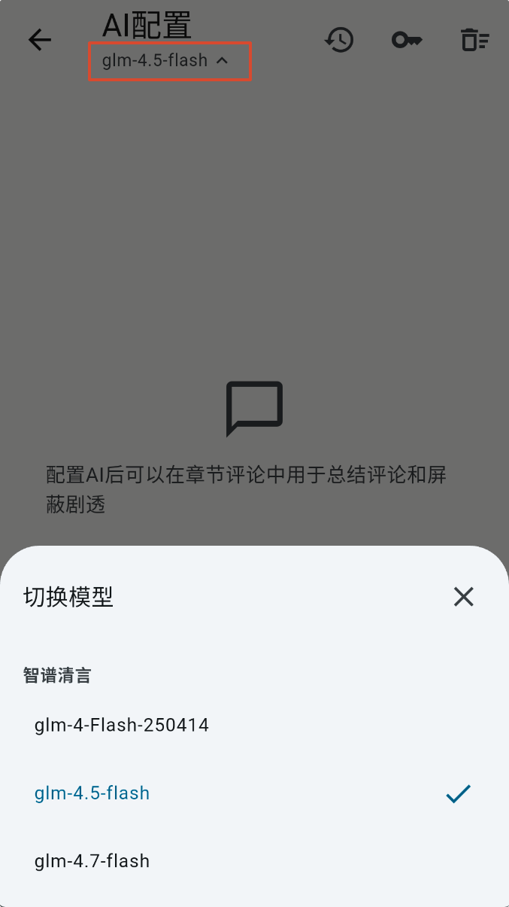
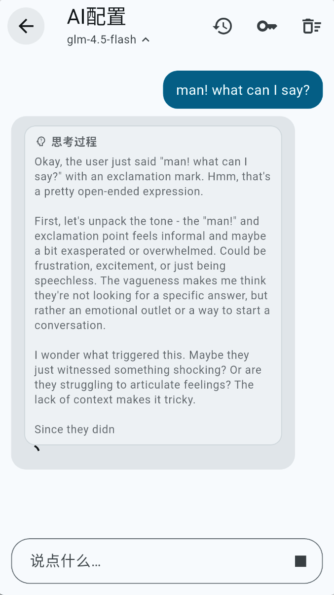
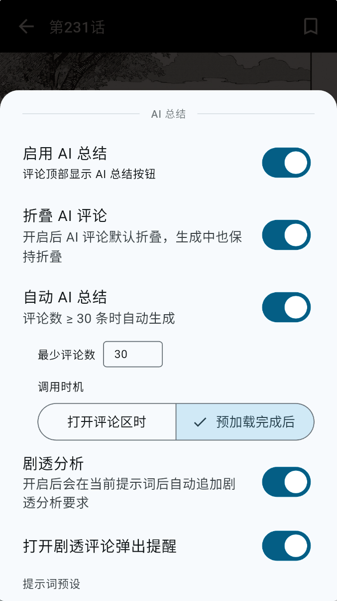
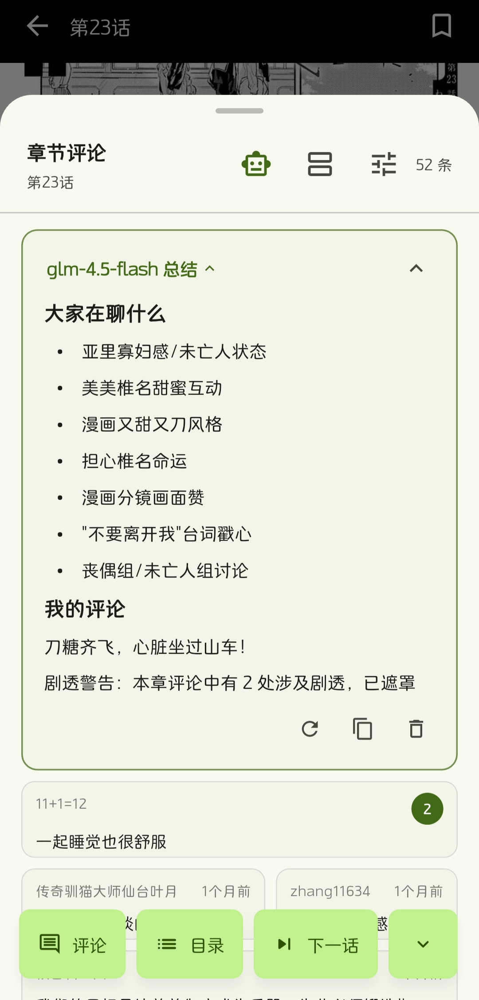

# AI配置

## 有什么用？

配置AI之后可以：

1. 总结章节评论
2. 屏蔽有剧透嫌疑的评论

## 配置

AI配置目前仅支持openai接口，下面以能免费使用的「智谱清言」为例，进入AI配置界面之后，点击顶部**钥匙**按钮，然后点击**编辑**按钮

滑到底部，点击「获取智谱API密钥」，或者直接打开链接 <https://open.bigmodel.cn/apikey/platform>，首次使用需要注册

登录完成后来到这个界面[智谱AI开放平台](https://open.bigmodel.cn/apikey/platform)创建一个密钥，随便填个名字然后复制一下，粘贴到 kira 中的`API Key`输入框即可

## 测试

可以先简单测试一下配置是否正确，默认已经设置了三个模型，目前推荐使用`glm-4.5-flash`，4.7容易限速

能正常输出说明配置没问题

## 如何使用

随便打开一个漫画的章节，然后打开评论，然后打开评论区设置，打开「启用 AI 总结」项，除此之外其他的一些配置：

> [!TIP]
>
> - 折叠AI评论：AI的评论默认会被折叠
> - 自动AI总结：在评论数量超过设置的数量时会自动触发AI总结
> - 调用时机：
>     - 打开评论区时：打开评论区的时候AI开始总结
>     - 预加载完成后：「预加载」是指用户打开章节漫画的时候就开始加载评论而不是等到用户打开评论区的时候才加载，使用此项需要先打开上面的「预加载评论」开关（在AI总结配置上面）
> - 剧透分析：AI总结完成后，具有剧透嫌疑的评论会被遮罩住

完成配置后就可以在评论区看到一个机器人按钮，点击后会开始进行总结和剧透分析

